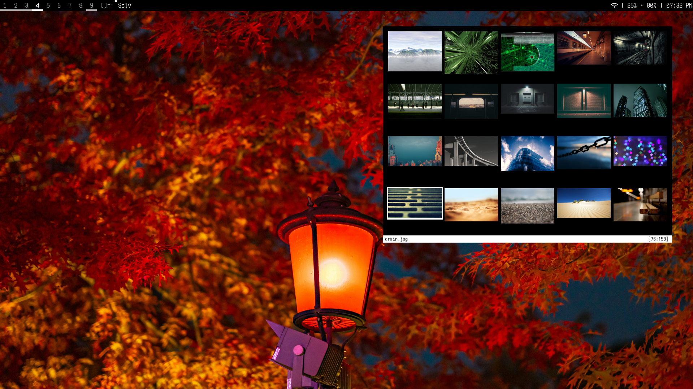
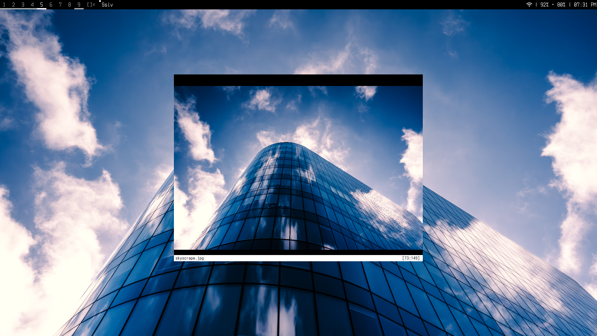

**Simple SDL Image Viewer**

The purpose of this ssiv is to be the perfect image for me, much like how the purpose of its predecessor project sxiv is for its creator.

Features
--------

* Thumbnail Mode: preview grid of selectable images
* Ability to set the wallpaper using exchangeable backends
* Vi bindings for movement
* Caching for fast reloads

Screenshots
-----------
***Thumbnailer Gallery Mode***: 
<br>

<br>
***Image Mode***:
<br>


Dependencies
------------

ssiv requires the following to be installed:
```
    * sdl3
    * sdl3_image
    * sdl3_TTF
```

Building
--------

ssiv is built using the following commands:
```bash
    $ make
    $ make install
```

NOTE: The default path is /usr/bin/ssiv.
